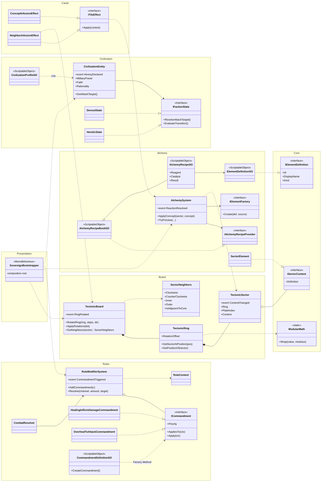
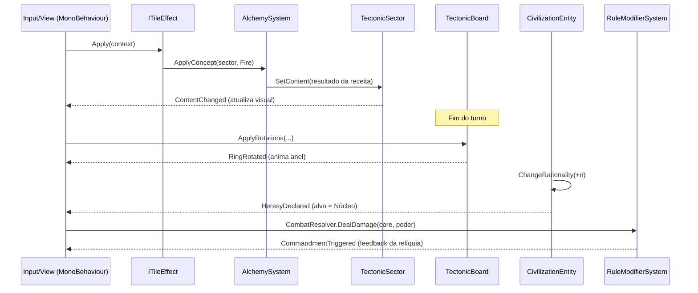

# Sovereign of Ashes — Arquitetura

## Camadas e namespaces

| Namespace | Responsabilidade | Depende de Unity? |
|---|---|---|
| `SovereignOfAshes.Core` | Tipos compartilhados (`ConceptType`, `IElementDefinition`, `ISectorContent`, `ModularMath`) | Não |
| `SovereignOfAshes.Board` | Crosta Viva: anéis, rotação modular, vizinhança | Não |
| `SovereignOfAshes.Alchemy` | Fusões data-driven (sistema POCO + ScriptableObjects de dados) | Só os `*SO` |
| `SovereignOfAshes.Cards` | Efeitos de carta (`ITileEffect`, Strategy) | Não |
| `SovereignOfAshes.Civilization` | Livre-Arbítrio: status e State Pattern de Heresia | Só o `*SO` |
| `SovereignOfAshes.Rules` | Mandamentos Divinos: pipeline/Chain of Responsibility | Só os `*SO` |
| `SovereignOfAshes.Invaders` | Invasores: `InvaderRoster` (ocupação das placas), ondas, recompensa em Fé | Só os `*SO` |
| `SovereignOfAshes.Turns` | Ciclo de turnos: `TurnSystem` + fases (`ITurnPhase`) + planejador tectônico | Só o `*SO` |
| `SovereignOfAshes.Economy` | Fé do jogador: `FaithPool` (reserva), `FaithIncomeService` (renda por turno via Mandamentos) | Só o `*SO` |
| `SovereignOfAshes.Session` | `GameSession` (monta a partida), `DefaultContent`, `GameLog`/`GameNarrator` (crônica), `PlayerActionService` (fachada das ações do jogador) | Não |
| `SovereignOfAshes.Presentation` | `SovereignBootstrapper` (SOs → config), `SovereignGameView` (HUD IMGUI + input), `BoardRenderer` (malhas geradas), `BoardLayout` (geometria pura, testada) | Sim (exceto `BoardLayout`) |

Regra de dependência: **Presentation → (Rules, Civilization, Cards, Alchemy) → Board → Core**. Nada aponta para Presentation; a lógica fala com a visão apenas por eventos (Observer).

## Diagrama

## Fluxo de um turno

## Padrões aplicados

| Padrão | Onde |
|---|---|
| Observer | `RingRotated`, `ContentChanged`, `ReactionResolved`, `HeresyDeclared`, `CommandmentTriggered` |
| Strategy | `ITileEffect` (cartas), `ICommandment` (mandamentos) |
| State | `IFactionState` → `DevoutState` / `HereticState` (com histerese de redenção) |
| Chain of Responsibility | `RuleModifierSystem.Resolve` com prioridade, `StopPropagation` e `Redirect` |
| Factory | `IElementFactory` (resultado da fusão), `CommandmentDefinitionSO.CreateCommandment()` |
| Data-Driven | `ElementDefinitionSO`, `AlchemyRecipeSO`, `AlchemyRecipeBookSO`, `CivilizationProfileSO` |
| Composition Root / DI | `SovereignBootstrapper` |

## Matemática do tabuleiro

- Cada placa tem um índice fixo `p`; cada anel guarda um deslocamento `o`.
- Posição angular atual: `pos = (p + o) mod N`. Placa numa posição: `p = (pos − o) mod N`.
- Girar `k` passos: `o = (o + k·dir) mod N`, em O(1) (nenhum objeto é movido).
- Vizinhos de `pos`: laterais `pos ± 1` no mesmo anel; radiais na **mesma `pos`** dos anéis `índice ± 1`.
- `ModularMath.Wrap` garante resto não negativo (o `%` do C# devolve negativo para `-1 % 8`).

## Ciclo de turnos

`TurnSystem` executa uma lista ordenada de `ITurnPhase`. Cada fase devolve `Continue`, `AwaitPlayer` (o jogo para até `EndPlayerTurn()`) ou `EndGame(...)`. Depois da última fase, o próximo turno começa pela primeira.

| # | Fase | O que faz |
|---|---|---|
| 1 | `FaithIncomePhase` | Recolhe a Fé do turno (Núcleo + civilizações devotas, passando pelos Mandamentos) |
| 2 | `PlayerActionPhase` | Para e espera o jogador jogar cartas e encerrar o turno |
| 3 | `TectonicShiftPhase` | Aplica as rotações do `ITectonicShiftPlanner`, que é determinístico e permite à UI mostrar a rotação seguinte |
| 4 | `CivilizationPhase` | Racionalidade +N; devotas atacam o invasor mais perigoso, hereges atacam o Núcleo (Poder Militar, via `CombatResolver`) |
| 5 | `InvaderAdvancePhase` | Invasores avançam um anel para dentro, até o setor alinhado; no Santuário Interno, atacam o Núcleo |
| 6 | `ElementEffectsPhase` | Os elementos da alquimia agem (Forja queima, Espectro drena, Santo acalma, Cinzas e Altar rendem Fé); mortos são removidos e geram recompensa |
| 7 | `InvaderSpawnPhase` | Novas ondas surgem em placas livres dos Ermos Externos |
| 8 | `GameOverCheckPhase` | Derrota se o Núcleo morreu; vitória ao chegar no turno N |

A `DrawPhase` (compra) vem logo depois da renda e antes da fase do jogador.

Proteções: chamar `EndPlayerTurn` fora da vez do jogador ou de dentro de uma fase lança exceção. Um turno inteiro sem fase de jogador também lança exceção, em vez de travar o jogo num loop.

**Nova fase** (ex.: invasores, eventos aleatórios): implemente `ITurnPhase` e inclua na lista em `SovereignBootstrapper.BuildTurnSystem()`.

## Interface

- **Zero configuração:** `SovereignGameView` gera a câmera, o tabuleiro (uma malha por placa, shader `Sprites/Default`) e o HUD em IMGUI. O IMGUI funciona com qualquer sistema de Input e não precisa de pacotes.
- **Só lê e chama:** a view lê o estado da `GameSession` e envia ações pelo `PlayerActionService`. Nenhuma regra fica na camada visual.
- **Animação desacoplada:** a lógica resolve o turno na hora. A view anima a rotação visual de cada anel (deslocamento contínuo seguindo `RingRotated`) e a marcha dos invasores. A entrada fica bloqueada enquanto anima.
- **Clique:** `BoardLayout.TryPick` converte o ponto do mundo em (anel, posição) por coordenadas polares, sem colliders nem raycast.
- **Previsão da marcha:** `MarchForecaster` (lógica pura, em `Invaders`) calcula o que cada invasor fará no próximo turno, aplicando as rotações planejadas e consultando ocupação e barreiras (`ElementEffectSystem.WouldBlock`, sem efeitos colaterais). Um teste compara a previsão com a `InvaderAdvancePhase` real em 300 cenários aleatórios. A interface desenha pontos até o destino, seta, escudo ou espada.
- **View em duas partes:** `SovereignGameView` (estado, animação, entrada) e `SovereignGameView.Hud.cs` (painéis, retratos, pilhas, carta ampliada, fim de jogo), como `partial class`.
- **Tabuleiro enfeitado:** `BoardDecor` gera raios de alinhamento, aros de bronze, faixa de runas girando, sombra e halo do Núcleo; `BoardRenderer.SetBackdropRect` faz o fundo pintado cobrir a tela sem distorcer.
- **Pinturas opcionais:** `ArtLibrary.Painting("UI/backdrop")` etc. carregam de `Resources`; sem o arquivo a interface cai no desenho por código.
- **IMGUI escalado:** `GUIUtility.RotateAroundPivot` espera o pivô em coordenadas de tela; `GuiTheme.RotateAroundGuiPivot` converte pela `GUI.matrix` (sem isso o pivô sai deslocado quando o HUD está escalado).
- **Cartas globais:** `AllowedRings = None` são jogadas direto da mão (Sermão, Milagre, Recrutar).
- **Baralho:** `CardDeck` (compra, mão, descarte, reembaralha) e `DrawPhase` (descarta a mão e compra 5 no início do turno).

Ordem completa do turno: Renda → **Compra** → Jogador → Rotação → Civilizações → Marcha → **Efeitos Alquímicos** → Surgimento → Julgamento.

## Alquimia com efeitos de jogo

Fundir elementos não só troca o desenho: cada elemento criado tem **efeitos** (`ElementEffect`, Strategy), executados pelo `ElementEffectSystem` (POCO).

| Elemento (receita: no setor + conceito jogado) | Efeito |
|---|---|
| Forja Sagrada (Ferro + Fogo) | `BurnEffect`: 3 de dano ao invasor no setor, 1 nos vizinhos, todo turno |
| Golem de Ferro (Carne + Ferro) | `BarrierEffect`: bloqueia a marcha, fere quem tenta passar (2) e aguenta 3 investidas |
| Santo Vivo (Carne + Fé) | `CivilizationPulseEffect`: -1 de Razão por turno |
| Espectro (Sangue + Medo) | `LifeDrainEffect`: 2 de dano a invasores no setor e vizinhos; cura o Núcleo em 1 por invasor atingido |
| Cinzas (Fogo + Tempo) | `FaithSpringEffect`: +1 de Fé por turno |
| Altar de Sacrifício (Fé + Sangue) | `FaithSpringEffect` (+2) e `CivilizationPulseEffect` (+1 de Razão): Fé em troca de heresia |

- **Ordem importa:** a receita é *(o que já está no setor, conceito jogado)*. Com uma carta de infusão selecionada, o tooltip do setor mostra o resultado ("Funde em: Forja Sagrada" ou "Sem reação").
- **Dois pontos de entrada:** `OnTurnEnd` (efeito periódico, na `ElementEffectsPhase`) e `BlocksInvader`/`OnInvaderBlocked` (a barreira consulta a `InvaderAdvancePhase` pela interface `ISectorBarrier`, então a marcha não conhece a alquimia: DIP).
- **Estado por instância:** os efeitos são sem estado e compartilhados; a durabilidade do Golem fica em `SectorElement.GetCounter/SetCounter`.
- **Mandamentos valem:** dano, cura e Fé dos efeitos passam por `CombatResolver`/`FaithIncomeService`, com o elemento como `Source`.
- **Dados:** `IElementEffectProvider` (padrão: `ElementEffectCatalog` por id de elemento, em `DefaultContent.CreateElementEffects`). Efeitos ainda não têm ScriptableObject: elementos de um `AlchemyRecipeBookSO` só agem se o id coincidir com o do catálogo.
- **Grimório:** a interface lista receitas e efeitos via `IAlchemyRecipeCatalog` (botão ou tecla **G**).
- **Novo efeito:** herde de `ElementEffect` e registre no catálogo; novo elemento: receita + id no catálogo.

## Invasores

- **Ocupação separada:** o `InvaderRoster` registra qual invasor está em qual placa, no máximo um por placa. Isso é independente do conteúdo alquímico do setor. Como o invasor fica na *placa*, ele gira junto com o anel.
- **Marcha:** o invasor vai para `GetNeighbors(setor).Inner`, então **a rotação dos anéis decide a rota**. Os invasores são processados do mais interno para o mais externo, para a fila andar no mesmo turno. Setor de destino ocupado = o invasor espera.
- **Prioridade de alvo** das civilizações devotas: o mais perto do Núcleo; empate → maior ataque; empate → menor vida.
- **Recompensa:** o `InvaderBountyRewarder` ouve `InvaderSlain` e concede Fé via `FaithIncomeService.GrantFaith`, que passa pelos Mandamentos.
- **Cartas de ataque:** `InvaderStrikeEffect` (asset `InvaderStrikeEffectSO`) causa dano ao invasor do setor alvo e, se configurado, aos invasores dos vizinhos laterais e radiais. O dano passa pelo `CombatResolver`, com a carta como `Source`, então Mandamentos podem afetar só dano de carta. Mortos são removidos na hora e a recompensa sai automaticamente. Cartas com `RequiresInvader` só podem mirar setores com invasor.
- **Ondas:** `InvasionWave` define primeiro turno, quantidade, período e crescimento a cada repetição. As posições de surgimento usam um `System.Random` injetado; uma semente fixa torna a partida reproduzível.

## Economia de Fé

- `FaithPool`: saldo limitado a uma capacidade; o excedente é perdido. Quem só gasta recebe `IFaithWallet`.
- Renda do turno = renda base do Núcleo + `Fé da civilização × %` para cada civilização **devota** (hereges não rendem).
- Cada fonte de renda passa separadamente pelo canal `ResourceGain` do `RuleModifierSystem`, com a fonte como `Source`.
- `CardResolver` valida o alvo e a Fé antes de cobrar; uma jogada recusada nunca gasta Fé.

## Como criar conteúdo novo sem tocar no código existente

- **Nova fusão:** crie um `AlchemyRecipeSO` e adicione-o ao `AlchemyRecipeBookSO`.
- **Nova carta:** crie um `CardDefinitionSO` e arraste os assets de efeito (`CardEffectDefinitionSO`) na ordem desejada. Só escreva código se precisar de um efeito inédito: implemente `ITileEffect` + um `CardEffectDefinitionSO` que o crie. O `CardResolver` valida o alvo (anéis permitidos, setor vazio) e executa os efeitos.
- **Novo mandamento:** herde de `CommandmentBase` e crie um `CommandmentDefinitionSO` correspondente.
- **Novo comportamento de facção:** implemente `IFactionState` (ex.: `FanaticState`).
